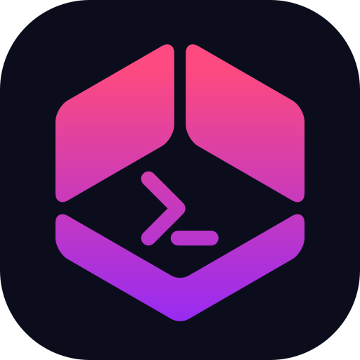
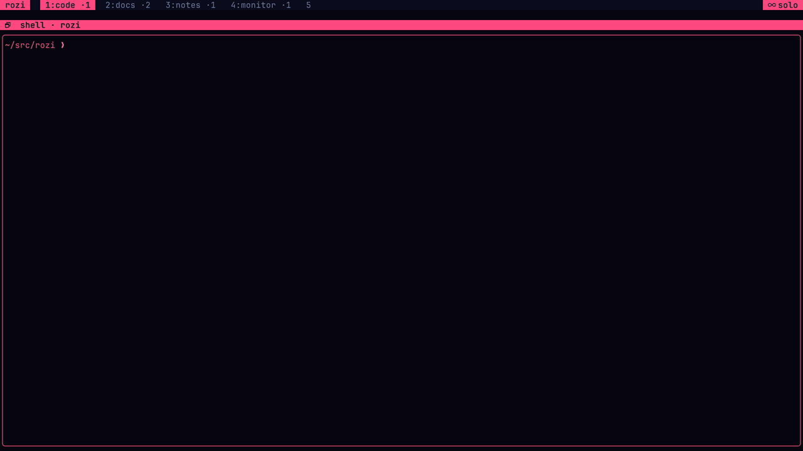

<p align="center">
  
</p>

<h1 align="center">rozi</h1>

<p align="center">
  A tiling terminal multiplexer. Your terminals, tiled like a window manager.
</p>

<p align="center">
  <a href="https://rozi.tui-lipan.dev">Website</a>
  ·
  <a href="https://github.com/tui-lipan/rozi/actions/workflows/ci.yml">CI</a>
  ·
  <a href="LICENSE">MPL-2.0</a>
</p>

<p align="center">
  
</p>

rozi is a terminal multiplexer built for how terminals get used now: several coding agents at
once, work spread across machines, terminals that show images, and Windows next to Linux and
macOS. Panes tile themselves the way a tiling window manager places windows, sessions keep running
after you leave, and everything you can do by hand, you can also script.

### Tiling

- Seven layouts: dwindle, master, grid, columns, rows, monocle, and a scrollable strip wider than
  the screen. Floating and fullscreen panes, nine workspaces per session.
- A mouse that works everywhere: focus, resize splits, drag floating panes, click hints.
- Themes, frames, layouts, and keys preview live as you browse them and save to one config file.
  31 themes are built in.

### Coding agents

- rozi recognises 23 agent CLIs, including Claude Code, Codex, and opencode, and shows which are
  working, finished, or waiting for you, across every session and connected machine.
- One key jumps to the next agent that needs you. The Projects tab groups agents by repository and
  checkout, and Git worktrees open in their own sessions.
- Agents can drive rozi themselves: rozi ships a skill that teaches them its CLI, and one agent can
  ask another a question and wait for the answer.

### Remote machines over SSH

- Local and remote sessions are in one picker. rozi installs itself on the host, uses your OpenSSH
  config and keys, and reconnects when the connection drops; the remote session keeps running.
- Ctrl-click a file path in a remote pane and it opens on your machine. Paste or drop files onto a
  remote pane and they are uploaded and their remote paths are typed in.
- A `localhost` link in a remote pane opens through an automatic SSH port forward. The clipboard,
  your theme, and your keys stay local.

### A full terminal

- Images through the Kitty graphics protocol, shown as Kitty, iTerm2, or sixel graphics depending
  on your terminal. Video in a pane stays current instead of falling behind.
- Drag and drop between panes and other applications, clickable links and file paths, copy mode,
  scrollback search, and shell integration.

### Sessions

- Named sessions survive detaching. After a crash or a reboot, rozi restores the layout, the
  scrollback, and the commands and agent conversations that ran in them.
- Several clients can attach to one session and hand layout control between them, including users
  of other accounts on the same machine.
- Updating rozi does not end running sessions.

### Scripting and extensions

- Every action is a CLI command with JSON output: open panes, send keys, wait for text to appear,
  capture a pane as text, JSON, or PNG, and record it for replay, as PNG frames, or as an
  asciinema cast.
- Hooks run on pane, workspace, and session events. Extensions are plain processes in any language
  that add commands, pickers, and sidebar tabs, can run on the remote host, and install from an
  in-app gallery.

Tiling behavior and keyboard flow take their cues from the
[Hyprland](https://hypr.land) window manager.

## Install

```bash
curl -fsSL https://rozi.tui-lipan.dev/install | bash
```

```powershell
irm https://rozi.tui-lipan.dev/install.ps1 | iex
```

You can also install with Cargo:

```bash
cargo install rozi --locked
```

Building from source requires Rust 1.96 or newer. See [Installation](docs/installation.md) for
PATH setup, updates, rollback, and source builds.

There are also [nightly builds](docs/installation.md#nightly-builds): a disposable binary of the
newest `master` commit that passed CI, for trying a fix before it is released. They are unsigned,
replaced every night, and no install or update path selects them.

rozi adds itself to an anonymous weekly count of active installs, with no ID or personal data.
[Usage count](docs/usage-count.md) lists exactly what is sent and how to opt out.

## First five minutes

Run `rozi`. The session picker opens; nothing starts until you choose.

For work you want to return to, type a session name such as `dev` and press `Ctrl+N`. For a
throwaway shell, press `Enter` while the list is empty, or `Ctrl+T` once it shows sessions.

Most commands start with the prefix, `Ctrl+A` by default. Press it, release it, then press the
command key:

| Keys | Action |
| --- | --- |
| `Ctrl+A`, `Enter` | Split the focused pane |
| `Ctrl+A`, `h` / `j` / `k` / `l` | Move focus |
| `Ctrl+A`, `p` | Open the command palette |
| `Ctrl+A`, `?` | Show active keybindings |
| `Ctrl+A`, `d` | Detach from a named session |

Attach to the named session again with:

```bash
rozi sessions attach dev
```

## Compared with tmux and zellij

tmux is smaller, runs nearly everywhere, and has almost twenty years of scripts and plugins behind
it. zellij has WASM plugins, layout files, and a web client. rozi is for you if you would rather
not split panes by hand, run coding agents you need to keep an eye on, or work across machines and
operating systems: it places panes like a tiling window manager, treats SSH hosts as part of the
same workspace, and tracks every agent on every connected machine.

## Documentation

The full documentation is at [rozi.tui-lipan.dev](https://rozi.tui-lipan.dev). Good places to
start:

- [Getting started](docs/getting-started.md) — a guided first session
- [Core concepts](docs/core-concepts.md) — sessions, panes, workspaces, and profiles
- [Overview](docs/overview.md) — what rozi can do, grouped by task
- [Keybindings](docs/keybindings.md) — the default keys
- [Configuration](docs/configuration.md) — the `config.toml` reference

The [documentation index](docs/index.md) lists every guide.

## Platforms

rozi supports Linux, macOS, and Windows. Windows requires Windows 10 version 1809 or newer.
Some process inspection and shell integration details differ by platform.

It also builds and runs on NetBSD, where it is packaged in pkgsrc. That platform is
community-supported: no prebuilt binaries, and CI builds and tests it without gating a merge.

See [Platform support](docs/platform-support.md), and its
[Windows limitations](docs/platform-support.md#windows-limitations) before you use rozi on Windows.

## How rozi is built

rozi's interface is one application written with [tui-lipan](https://tui-lipan.dev), a component
framework for terminal apps built alongside it. Coding agents wrote most of the code in both
projects, directed and reviewed by one person, under the rules in [`AGENTS.md`](AGENTS.md): tests
that exercise production behavior instead of stand-ins, benchmarks behind performance claims, and
a [wire-compatibility policy](dev/wire-compatibility.md) so an update never ends a running
session.

## Contributing

Contributions require a Developer Certificate of Origin sign-off. See
[CONTRIBUTING.md](CONTRIBUTING.md).

## License

rozi is licensed under the [Mozilla Public License 2.0](LICENSE).
