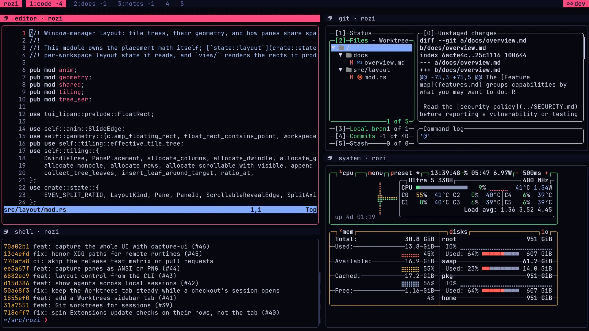

# Overview

rozi is a tiling terminal multiplexer: it arranges terminal panes the way a tiling window manager
arranges windows. It keeps named sessions running after you leave, reaches other machines over SSH,
and shows which coding agents need you. You can change any of it live, from inside rozi.

Shells, editors, system monitors, test servers, and coding agents are all ordinary panes. The
sidebar also shows which coding agents are working, finished, or waiting for your input, on this
machine and on connected hosts. The sections below list what rozi can do and point to the guide
for each.

Tiling behavior, animations, and keyboard flow take their cues from the
[Hyprland](https://hypr.land) window manager.

<CaptureGallery title="~/src/rozi — dev">

</CaptureGallery>

## Arrange terminal work

- Split the focused pane and let the current layout place the new pane.
- Choose between dwindle, master, grid, columns, rows, scrollable, and monocle layouts.
- Move, swap, resize, float, or fullscreen panes.
- Organize panes across nine workspaces.
- Use the mouse for focus, split resizing, floating pane movement, and overlay footer hints.

See [Layouts and panes](layouts-and-panes.md) and [Keybindings](keybindings.md).

## Use a full terminal

- Run any interactive program, just as in a regular terminal.
- Search scrollback and copy with keyboard motions.
- Select text, use the clipboard, open links, and show terminal images.
- Forward mouse input to programs that request it.
- Use shell integration for working directories, prompt boundaries, and the last command's output.
- Save a PNG screenshot of the focused pane or the whole window from the command palette.

See [Terminal features](terminal.md).

## Leave work running

- Create named sessions that keep their live panes after clients detach.
- Optionally keep the system awake while agents work, including after detaching.
- Attach several clients to one named session and hand layout control between them.
- Attach to sessions on another machine over SSH.
- Use temporary sessions for work that does not need a durable name.
- Save reusable launch setups as profiles.
- Create Git worktrees and open each in its own session, from the sidebar's Worktrees tab, a picker,
  or `rozi worktrees`. Spot and clear locks left behind by agents that have exited.

See [Sessions](sessions.md), [Remote sessions](remote.md), [Profiles](profiles.md), and
[Worktrees](worktrees.md).

## Find and monitor work

- Open commands from a searchable palette and inspect active bindings in the help overlay.
- Use independent left and right sidebars with up to three panels each to browse panes, sessions,
  files, Git changes, and coding-agent activity. Resize panels, move tabs between docks, and manage
  hidden or unavailable tabs through a searchable picker.
- See at a glance whether each coding agent is working, blocked on your input, or finished.
- Jump to panes that need input and show alerts in pane borders or workspace tabs.
- See which agents want attention on a connected remote host, without attaching to a session there.
- List every agent on every connected machine in one view, and go to any of them with one key.
- Keep that list in the sidebar's Agents tab, so the agent that is blocked on any machine stays in
  sight while you work.
- See every repository you work in, on every machine, in the sidebar's Projects tab: its checkouts
  by branch and the sessions working in each, marked with their most urgent agent.
- Add sidebar tabs of your own that list a tree of rows from a script, or that running programs and
  extensions keep up to date as things change, one section per machine.

See [Sidebar](sidebar.md#activity), [the Agents tab](sidebar.md#agents),
[the Projects tab](sidebar.md#projects), [custom tabs](sidebar.md#custom-tabs),
[the Agents view](sessions.md#go-to-an-agent),
[agent definitions](configuration.md#agents),
[Agents on a machine you are not in](remote.md#agents-on-a-machine-you-are-not-in), and
[Agent skill](agent-skill.md).

## Change the interface

- Rebind built-in commands or add commands that open a pane and send text.
- Change layouts, borders, gaps, titlebars, animations, and the workbar.
- Choose a built-in or system theme, or add a custom theme file.
- Reload configuration and themes when their files change.

See [Configuration](configuration.md), [Keybindings](keybindings.md), and [Themes](themes.md).

## Automate rozi

- Inspect panes and run actions from scripts.
- Read each workspace's layout and every pane's position, and subscribe to layout changes.
- Float, place, fullscreen, re-tile, move, swap, resize, or close panes by id.
- Send keys or text, open panes, and switch workspaces.
- Capture a pane as plain text, ANSI-colored text, a PNG image, or JSON runs of styled text with
  the cursor and images, or capture the whole UI as drawn.
- Send input and wait for the pane to answer, or capture once a pane shows some text or stops
  changing, instead of sleeping between steps.
- Drive a detached session with no client attached: list, capture, type, and open panes from a
  script or an SSH login that never starts a terminal.
- Record a pane's screen change by change, from the command palette or a script and even with no UI
  attached, then replay it in a terminal or export PNG frames for a GIF or video, or an asciinema
  cast. Record the whole UI as you see it, chrome included, for a demo or a bug report. See
  [Record a pane or the UI](recording.md).
- Run hooks when pane, focus, workspace, session, or profile events occur.
- Build extensions with static navigation targets plus out-of-process commands, services, tabbed
  pickers, activity rows, and notifications.
- Place an extension's commands, services, and sidebar tabs on the host of an attached session, so
  they run on a remote machine from a verified copy of the extension and reach your client only
  through rozi. See [Run on the session host](writing-extensions.md#run-on-the-session-host).
- Discover public `rozi-extension` repositories in-app and install their exact indexed commits after
  reviewing source, compatibility, and contribution counts.

See [Scripting](scripting.md), [Control CLI](control.md), [Hooks](hooks.md), and
[Automation recipes](recipes.md).

## Use it on your operating system

rozi supports Linux, macOS, and Windows. Shell integration, process inspection, paths, and PTY
support differ where the operating systems require it. NetBSD builds and runs from pkgsrc as a
community-supported platform.

See [Platform support](platform-support.md) and [Installation](installation.md).
