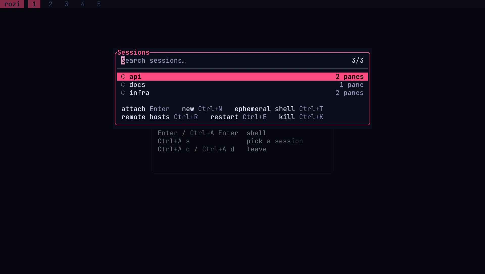

# Sessions

A session is a set of workspaces and panes that keeps running in a background session server. This
page covers opening, switching, naming, and leaving sessions, what happens at startup, and how rozi
restores sessions after the server stops.

By default, a bare `rozi` opens the session picker without creating or attaching to a session. From
there you choose a running session, restore a saved one, create a named session, or start a
temporary shell. See [Core concepts](core-concepts.md).

## Temporary and named sessions

| | Temporary | Named |
| --- | --- | --- |
| Typical use | Short work without choosing a name | Work you plan to return to |
| Leaving after use | Asks whether to name or close it | Keeps running |
| No clients attached | Closes after 45 seconds | Persists until killed |
| Picker label | `ephemeral` | Session name |

Naming a temporary session renames its existing server. Panes and processes keep running.

## Open a session from the command line

```bash
rozi                         # open the default picker
rozi dev                     # attach to dev, or launch profile dev
rozi --session dev           # same target, explicit spelling
rozi sessions attach dev              # attach only
rozi sessions attach dev --read-only  # attach without input or layout authority
rozi sessions attach dev --follow     # follow without prompting
rozi sessions attach dev --take-control # take or request layout control without prompting
rozi sessions new dev                 # create a fresh empty named session
rozi sessions new review --profile dev
rozi sessions new api --cwd ~/src/api  # first pane starts in ~/src/api
rozi sessions new scratch --detach    # start in the background, without a UI
rozi sessions new tests --detach --no-resurrect  # ... and never restore it
rozi sessions new scratch --detach --remote workbox  # ... on another machine
rozi sessions list
rozi sessions restart dev             # restart a running session, ending its programs
rozi sessions upgrade dev             # restart it on this release from its snapshot
rozi sessions kill dev
```

`rozi sessions attach <NAME>` requires a running session and reports an error if it is missing,
including with `--remote`. It never creates a session.

For a session another client controls, `[session] on_attach` chooses whether to ask, follow,
or request control. Set it in **Settings**, **Sessions**, **On shared attach**. `--follow` and
`--take-control` override it for one `sessions attach`; they conflict with each other and with
`--read-only`. Taking control follows the [running session's policy](shared-sessions.md#layout-control).

`rozi dev` attaches to a running session named `dev`. If there is none, it restores a saved
session named `dev`, or launches the profile named `dev` when nothing is saved. If none of these
exists, it reports an error. `rozi sessions kill <NAME>` also reports an error when no live or
restorable session has that name.

`--cwd` applies only to `sessions new` and cannot be combined with `--profile`. With `--remote`, it
names a directory on the remote host and is passed through unchanged, so use an absolute path.

Write each option after its command: `--follow` and `--take-control` belong to `sessions attach`,
`--profile`, `--cwd`, and `--detach` to `sessions new`, and `--no-resurrect` to
`sessions new --detach` and `sessions restart`. `--read-only`, `--remote`, `--config`, and `--pick` can go before or after
the session command.

Subcommand names cannot be bare session or profile targets. For a session or profile literally
named `attach`, use `rozi --session attach`.

`rozi sessions list` shows the rozi release and protocol generation each running session runs on;
`--format json` reports them as `rozi_version` and `effective_protocol`, and adds an `origin` object
for a session created from a profile or a Git worktree.

Remote hosts use the same session commands. See [Remote sessions](remote.md).

## Use the session picker

Press `Ctrl+A`, then `s` to open **Sessions**, or click the session badge in the workbar.

<CaptureGallery title="rozi">

</CaptureGallery>

Sessions has a **Local** tab, a tab for each remote host you are using, and **All**, which lists
every host's sessions together and labels remote ones `name@host`. It opens on the host of the
session you are in. To open on **All** every time, choose **Settings → Sessions → Open Sessions on
→ All sessions** or set `session.picker_open_on = "all"`.

Type to filter the selected tab, and press `Enter` to attach. To create a session, type a name and
press `Ctrl+N`; the footer shows which host it will be created on, such as **new on workbox**.
`Ctrl+T` starts a temporary shell, and with an empty list `Enter` does the same. In a temporary
session, `Ctrl+S` names it. `Ctrl+R` opens **Remote hosts**, and `Ctrl+X` disconnects the selected
host.

The marker before each name shows how the session stands with this client:

| Marker | Session |
| --- | --- |
| `●` | The one you are in |
| `◐` | Held by this client in the background |
| spinner | Held by this client and reconnecting |
| `×` | Held by this client, with its connection lost; `Enter` reconnects |
| `○` | Running, with this client not attached |
| `◌` | Saved; `Enter` restores it |
| `·` | Remembered from a host, or not answering |

Rows are listed in that order: the session you are in, the others this client holds, running
sessions, saved sessions, then remembered ones. Within each group, local sessions come first, then
each host's by name.

A session with nothing running to attach to says so first — `Restorable`, `Unreadable`, `Last seen`,
`Busy`, or `Unavailable`. The rest of the row shows its pane count, what its agents are doing, how
many other clients share it, and the profile it was created from.

Opening Sessions does not start a remote connection. With `[remote] reconnect_on_launch = true`,
remembered hosts reconnect in the background when rozi starts. Sessions on remote hosts are listed
from the last time each host answered: a host's tab shows its state in the picker's top-right
corner, and rows on a host this client is not attached to are marked `Last seen`, with the pane
count the host last reported:

```text
╭Sessions────────────────────────────────────Disconnected╮
│ Search sessions…                                   1/1 │
├───────────────────────────────────────────────────────┤
│ Local   workbox                                        │
│                                                       │
│ · dev                              Last seen · 3 panes │
```

On a `Last seen` row:

- `Enter` connects the host and attaches to the session.
- `Ctrl+E` is unavailable, because rozi cannot confirm the session is still running.
- `Ctrl+K` twice forgets the entry locally, without contacting the host. If the host still reports
  the session later, it is listed again.

To kill or restart a session on a remote host, connect the host first: press `Ctrl+R`, then connect
the host and open its Sessions tab, or expand it in the Sessions sidebar.

## Scope: where an action happens

Each picker names the scope it acts in, and its keys act only in that scope.

| Surface | Scope | `Ctrl+N` | `Ctrl+T` |
| --- | --- | --- | --- |
| **Sessions** | The browsing host; on All, the foreground or launcher host | New named session on that host | Temporary shell on that host |
| **Remote hosts** | Host management | Add a host | — |

Attached to `backend@workbox`, Sessions opens on the `workbox` tab, so `Ctrl+N` creates a session on
`workbox`. Switch to **Local** to create one on this machine. See
[Manage remote hosts](remote.md#manage-remote-hosts).

## Switch sessions

Switching to another session keeps the previous one connected in the background, and its panes keep
receiving output. A background session gives up layout control; returning to it takes control again
when no other client has claimed it. `Ctrl+W` in the picker disconnects a background session.

An untouched temporary session is discarded when you switch away. A temporary session you have used
stays in the background.

Change the switch animation in **Settings** › General › Animations › Session switching, or with
`session` in [`[animations]`](configuration.md#animations).

## Go to an agent

Press `Ctrl+A`, then `a` to open **Agents**. It lists agents, not every Activity row: detected
coding agents, agents that report their own state, and rows from a publisher that declared itself
an agent. It covers the current session, other running named local sessions, and every
[connected host](remote.md#connected-host-monitoring), in sections: **Needs you** (agents waiting
for you, failed ones, and finished runs you have not looked at), **Working**, **Done**, and **Idle**.

```text
╭Agents────────────────────────────────────────────────────────────────────────────── dev╮
│ api   dev   backend@workbox   All                                                      │
│ Needs you                                                                              │
│ ▲ fix login · Claude Code  Blocked 2m10s · Permission required · dev · api (fix-login) │
│ × Codex                                                Thread failed · backend@workbox │
│                                                                                        │
│ Working                                                                                │
│ ⠋ review PR · Claude Code                      Working 4m00s · Current · rozi (master) │
│                                                                                        │
│ Idle                                                                                   │
│ ○ add filesystem watcher · Claude Code                             dev · rozi (master) │
╰────────────────────────────────────────────────────────────────────────────────────────╯
```

The frame names the session you are in, as `session` or `session@host`. **Agents** opens on **All**
with the agent you are in highlighted and marked **Current**: the agent in the focused pane, or for
a program running several agents there, the one it shows. When you are not in one, it opens on the
top row. Each session with agents also gets its own tab; switch tabs with `Tab`, `Shift+Tab`, the
arrow keys, or a click, and type to filter.

Each row leads with the agent's task when it names one, or else its terminal title, followed by the
agent's name. The glyph shows the agent's state. The right side adds, in order, the state with how
long it has held or what its run took, such as `Working 4m00s`, the reason an agent gave for waiting
or failing, **Current** on the agent you are in, the session it runs in, and the project and branch
it works in. The session appears only on **All** once agents run outside the session you are in: the
session name for local agents and `session@host` for remote agents. A run its program keeps in the
background has an italic task.

Search matches all of it — the task, the agent, the session, the host, the project and branch, and
the reason — so typing a branch or a host name narrows the list to the agents there.

`Enter` goes to the highlighted agent. In the session on screen, it moves focus to the agent's pane;
on the agent you are in, it only closes Agents. Anywhere else, rozi attaches to that session first
and then focuses the pane — and, for a program running several agents, the agent's own row inside
it. The host and session do not have to be open already.

Only agents in sessions this client holds, the one on screen or in the background, have a time. What an agent's terminal shows, as the
[Activity tab](sidebar.md#activity) reads it, needs an attached session; see
[Agents on a machine you are not in](remote.md#agents-on-a-machine-you-are-not-in).

To keep every agent in sight, show the sidebar's [Agents tab](sidebar.md#agents). To go to the next
agent that needs you without opening Agents, bind `focus-next-agent-needing-attention`; each press
goes to the next one after the agent on screen, in this list's order.

## Name or rename a session

Press `Ctrl+A`, then `S` to run **Name session** or **Rename session**. The same server, panes,
processes, and scrollback continue under the new name.

rozi rejects a name already used by a running session and names reserved for temporary sessions.

Later edits to the profile a session was created from do not change the running session. See
[Profiles](profiles.md).

## Leave rozi

`Ctrl+A`, then `q`, and `Ctrl+A`, then `d` run the same leave flow:

- Named sessions detach and keep running, including named sessions in the background.
- Untouched temporary sessions close without a prompt.
- Used temporary sessions open **Keep this session?**. Enter a name to keep the session running,
  submit an empty name twice to close it, or press `Esc` to go back.

Set `[confirm] quit_ephemeral = false` to close a used temporary session on the first empty name.

`rozi run-action quit` does not prompt and does not close a used temporary session. The temporary
server is left running so you can [recover it](#recover-a-temporary-session).

Killing the current session does not exit the client. rozi opens the picker if another session is
available, or returns to the sessionless launcher. Killing a named session also deletes its
[resurrection](#resurrection) snapshot.

## Choose startup behavior

`[session] startup` decides where rozi starts when you do not name a session:

| Value | Behavior |
| --- | --- |
| `picker` | Open the picker without attaching. This is the default. |
| `ephemeral` | Start a temporary shell immediately. |
| `last` | Reopen the most recently attached named session. |
| `profile` | Open the session named by `[profile] default`. |

A bare `rozi` uses the most recently attached named session across workplaces for `last`; other
startup values apply locally. `rozi --remote workbox` applies the setting on `workbox`:

| Value | `rozi --remote workbox` |
| --- | --- |
| `picker` | Connect, list sessions, and open **Sessions** on the **workbox** tab. No session is created. |
| `ephemeral` | Create or attach a temporary session on `workbox`. |
| `last` | Attach the last session used on `workbox` if it is still there, else **Sessions** on the **workbox** tab. |
| `profile` | Open or create the default-profile session on `workbox`, else **Sessions** on the **workbox** tab. |

An explicit `--remote` uses that host's own last session. A bare launch reopens a remote last session
only when the host is remembered for reconnecting and `[remote] reconnect_on_launch = true`.
Otherwise it opens Sessions without contacting that host. Remote sessions resume only when they are
still running, without SSH prompts or installation during an automatic reconnect. `profile` creates
its session when needed.

A session you name explicitly — as a target, with `sessions attach` or `sessions new`, or through
`--pick` — overrides `[session] startup`. If `last` or `profile` cannot find its session, rozi opens
that host's picker and reports why.

### The sessionless launcher

When no session is attached, rozi shows the sessionless launcher. Press `Enter` to start a temporary
shell, or use the spawn command.

A launcher can be scoped to a remote host without a session or an open SSH connection there:

```text
╭─REMOTE · workbox──────────────────────────╮
│ Enter / Ctrl+A Enter  shell on workbox    │
│ Ctrl+A s              pick a session      │
│ Ctrl+A q / Ctrl+A d   leave               │
╰───────────────────────────────────────────╯
```

You land here when you dismiss the picker after `rozi --remote workbox` with `startup = "picker"`,
or close **Sessions** on the **workbox** tab with nothing attached. `Enter` then starts a temporary
shell on `workbox`. Sessions opened from this launcher starts on the `workbox` tab, and switching
tabs there moves the launcher's scope with it.

Killing a remote session leaves you in that host's launcher. Opening another host, switching tabs in
Sessions, disconnecting the host with `Ctrl+X`, or forgetting it changes the launcher's scope;
browsing the host list or closing a picker without choosing does not.

## Recover a temporary session

If the client crashes or disconnects abnormally, a temporary session server waits 45 seconds after
its last client leaves. During that time, it appears as `ephemeral` in the picker and you can
reattach to it. After 45 seconds with no client, it shuts down, even if panes were still running.

## Resurrection

With `[session] resurrect = true`, the default, rozi saves a snapshot of each named session
periodically and when the last client detaches after a change. A session started with
`rozi sessions new <NAME> --detach --no-resurrect` is never saved.

When the session server is no longer running, the picker lists a usable snapshot as `Restorable`.
So is a session with [extensions deployed](extensions.md#deploy-to-a-session) to it, even if its
server stopped before saving anything, so that you can find it and reopen or delete it. Press
`Enter` on the row, or run `rozi <NAME>`, to restore it. Restoring recreates:

- workspace layouts, names, and pane placement
- pane commands and working directories
- commands running inside a shell pane, including their arguments
- pane titles and terminal palette
- saved terminal history, including its colors and text styling

Processes themselves are not saved. Each command starts again in a fresh terminal, with the saved
history shown above the new output. If a snapshot is damaged and a complete backup is available,
rozi restores the backup. When part of a snapshot cannot be read, rozi restores the rest and reports
a recovery warning in session notifications, and on stderr when restoring from the command line.

A snapshot rozi cannot read at all — saved by another rozi version in another format, or damaged
with no usable backup — is listed as `Unreadable` (`unreadable` in `rozi sessions list`). It is
kept but not restored: `Enter` says why, and opening the session by name is refused.

To discard a snapshot, press `Ctrl+K` twice on its `Restorable` or `Unreadable` row. `rozi sessions new <name>` also
starts fresh instead of restoring a snapshot with that name, and keeps any
[extensions deployed](extensions.md#deploy-to-a-session) to the session.

### Commands a pane was running

A pane created with a command, such as `rozi split -- btop` or a pane from a profile, restores by
running that command again.

A plain shell pane restores as a shell. If a command was running in it when the snapshot was taken —
an agent, an editor, a log tail, or a build typed at the prompt — rozi records the command with its
arguments and types it back when the new shell's prompt is ready.

Commands launched through a Node wrapper script, such as Cursor's `agent`, restore with their
arguments too. Commands under other interpreters restore by name only.

`[session] resurrect_foreground` decides what happens to a recorded command:

| Value | Restoring a shell that was running something |
| --- | --- |
| `auto` | Types the command back and runs it. |
| `hold` (default) | Types the command back and leaves it at the prompt. `Enter` runs it. |
| `never` | Restores the shell and its scrollback. No command is written to the snapshot. |

A running session keeps the value it started with; restart it to apply a change.

### Reopen an agent conversation

An agent that reports a native session reference (`rozi agents report --native-session`, or the
`native_session` of the active row its publisher marks), and whose
definition declares `[agents.resume]`, restores into its previous conversation instead of starting a
new one.

A pane restores the first of these that applies: a conversation to reopen, a command it was
running, the command it was created with, or a plain shell. Only one pane reopens a given
conversation.

`resurrect_foreground` applies here too:

| Value | Restoring a pane with a reported conversation |
| --- | --- |
| `auto` | Runs the resume command as the pane's first process. If the agent refuses it straight away and declares an [`attach`](agents.md#declare-native-resume-support) command, the pane runs that instead. |
| `hold` (default) | Types the resume command at the shell's prompt and leaves it there. A pane created to run the agent directly comes back as a shell for this, so nothing runs until you press `Enter`. When the agent declares an [`attach`](agents.md#declare-native-resume-support) command, as Claude Code does for a session still running in the background, the line falls back to it. |
| `never` | Writes no conversation reference to the snapshot at all. |

If the resume command fails, the pane keeps the agent's error on screen, names the failure, and
leaves a usable shell below it. rozi never starts a new conversation in place of one it could not
reopen, and from then on that pane is saved and restored as a plain shell.

Set `[session] resurrect_agents = false` to keep agent session references out of snapshots. It
defaults to `true`.

## Scratch panes

The scratchpad belongs to the client, not to the attached session, so scratch panes stay available
while you switch between local and remote sessions. They are not shared with collaborators, saved in
profiles, or included in resurrection snapshots, and exiting rozi ends them.

## Script a session with no client attached

A named session can be driven while no client is attached. Put a control command after
`rozi --session <NAME>`:

```bash
rozi --session dev list-panes
rozi --session dev capture-pane --target 3
rozi --session dev send-keys --target 3 'cargo test' Enter
rozi --session dev split --argv cargo watch -x test
```

This does not attach a client, so the session's client count and layout control are unchanged.

To give a script or a coding agent a session of its own, so its panes stay out of the sessions you
work in, start one with `rozi sessions new <NAME> --detach`. The command returns once the session
is running. The session starts with no panes, and its first `split` opens one. It cannot be
combined with `--profile` or `--cwd`; pass `--cwd` to `split` instead. Add `--remote <HOST>` to start
it on another machine. Stop the session with `rozi sessions kill <NAME>` when the work is done.

Like any named session, a detached session is saved for [resurrection](#resurrection) and appears
in the picker as `Restorable` if its server stops before `sessions kill`. Add `--no-resurrect` for
throwaway work: the session is never saved.

`rozi sessions restart <NAME>` ends a running session's panes and starts it again without a UI, on
the build you ran it with. It keeps [deployed extensions](extensions.md#deploy-to-a-session), and
`--remote <HOST>` restarts a session on another machine. A session started with `--no-resurrect`
needs the option again here to stay unsaved. A session that isn't running is refused; start it with
`rozi sessions new <NAME> --detach`.

A session whose server runs an [incompatible rozi version](troubleshooting.md#runs-an-incompatible-rozi-version)
restarts from its snapshot instead of with fresh panes: its layout and terminal history come back
as [resurrection](#resurrection) restores them, while the programs in its panes end. In Sessions,
`Ctrl+E` on such a row [upgrades](#upgrade-a-session) it. Output from the final moments before the
restart can be missing.

If this rozi cannot read the snapshot, the session is not started and its snapshot is kept, listed
as [`Unreadable`](#resurrection). For a snapshot in another format, start the session with the rozi
version that saved it. Otherwise, run `rozi sessions new <NAME> --detach` to start it empty and
discard the snapshot.

```bash
rozi sessions new tests --detach --no-resurrect
rozi --session tests split --cwd ~/src/api --argv cargo test
rozi sessions kill tests
```

A script has no more authority than an attached client. `split` is refused while any client holds
layout control, and typing respects the session's input lock. Commands that need a screen — focus,
workspace switching, toasts, pickers, actions, and event subscriptions — are refused with a reason.
See [Control CLI](control.md#two-endpoints) for the full list and
[Automation recipes](recipes.md) for examples.

## Upgrade a session

A session keeps running on the rozi release that started it, and a newer client attaches to it
normally. The sessions picker shows the release on the row when it differs from yours, and a
feature the session's release does not have is shown but disabled with the release it needs.

To move a session to your current release, run **Upgrade session** from the command palette, or
`rozi sessions upgrade <NAME>` (add `--remote <HOST>` for a session on another machine). The
session restarts from its snapshot on the current build: its layout and terminal history come back,
while the programs in its panes end. Like restarting, the command asks for a second press first.
The palette offers it only for a session on an older release, and `rozi sessions upgrade` refuses a
session on a newer one; upgrade that session from the newer rozi instead. rozi never upgrades a
session on its own: [Restart rozi](installation.md#restart-rozi-on-the-new-build) upgrades only the
sessions the new build cannot attach to, and only once you confirm it.

## Worktrees

rozi can open each Git worktree of a repository in its own named session, and create or remove
checkouts from the **Worktrees** picker or `rozi worktrees`. See [Worktrees](worktrees.md).

## Share a live session

More than one client can attach to a session. One client controls the shared layout, while each
client keeps its own focus, scrollback position, overlays, theme, and sidebar. See
[Shared sessions](shared-sessions.md) for handing over control, read-only attachment, input lock,
and removing collaborators.

## Limits and failure cases

- `rozi sessions list` lists sessions it can connect to. Stale or unrecognized session entries are
  skipped.
- If a session server cannot be reached, the client reports the failure. It does not create a blank
  session with that name.
- If a client loses its connection to a local session, it reconnects in place, retrying a busy
  server for up to 15 seconds. If that fails, the client leaves the session and opens the picker or
  the launcher. The server and its panes keep running if the server is still alive.
- If a remote session's connection drops or stops answering, a reconnecting overlay retries for up
  to two minutes; `Esc` cancels it. rozi never silently replaces a remote session that is gone. See
  [Reconnection and switching](remote.md#reconnection-and-switching).
- A client works with a session started by another release while both share a session protocol
  generation; the release notes say when a release starts a new one. A session on an older
  generation is listed as incompatible: [upgrade it](#upgrade-a-session), which reopens it from its
  snapshot, or update the other end.
- A session name belongs to one host. The same name on the local machine and on a remote host
  refers to two different sessions.

See also [Troubleshooting](troubleshooting.md).

## Keep the system awake

Enable **Settings → Sessions → Keep awake while agents work**, or set
`[session] keep_awake_while_agents_work = true`. The default is disabled. Each session server keeps
its host awake while any agent is Working, including agents in local panes and sessions whose UI has
detached. Agents are the ones listed by `rozi agents list`: detected agents,
[agent reports](agents.md#report-state-from-agent-hooks), and rows from a publisher that declared
itself an agent. A `rozi status` or a generic published row does not keep the host awake. Sleep is
allowed again five seconds after the last agent stops working.

Screen blanking and locking remain allowed, and there is no lid-switch lock. Linux requires
`systemd-inhibit` and logind; macOS uses `caffeinate`; Windows uses a system power request.
Unsupported hosts allow sleep and log an error.

Remote servers use the remote host's setting. While attached remotely, the Settings row is disabled
and shows **Configure on remote host**; edit the remote host's config and reload it instead.
