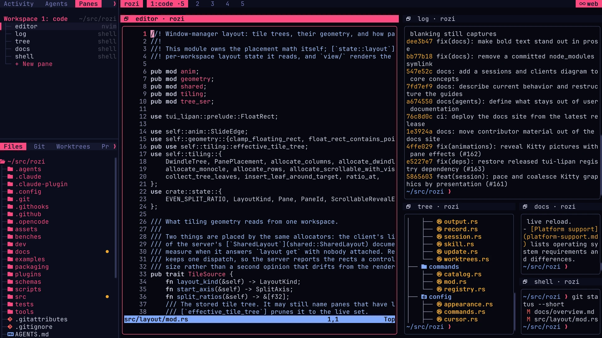
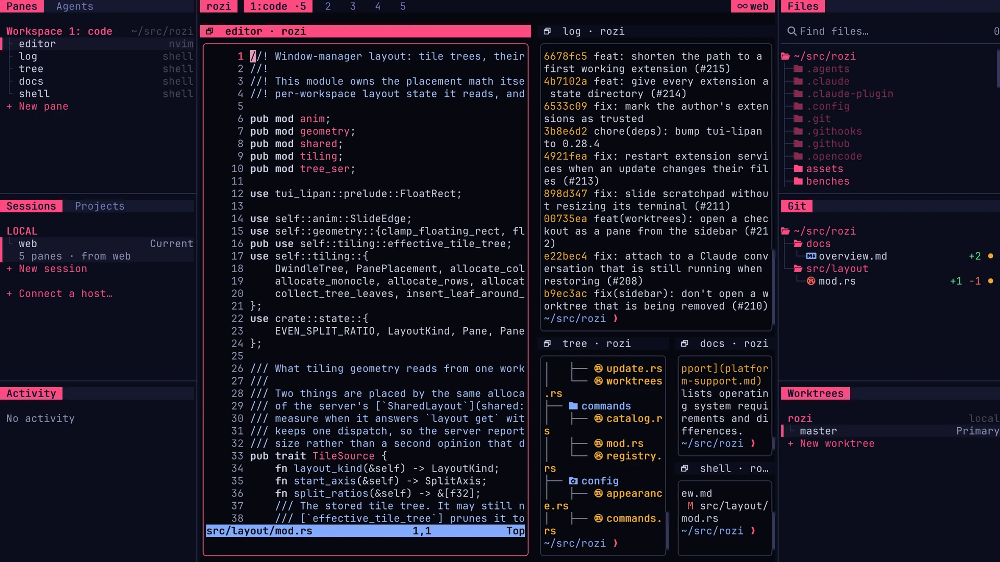
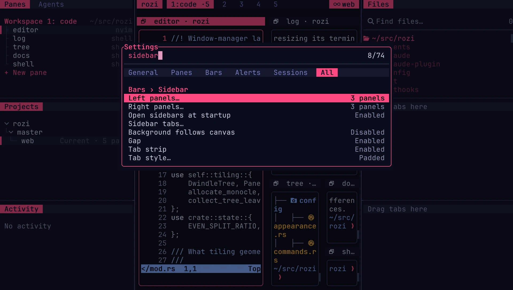
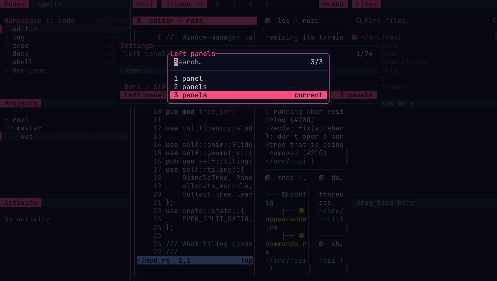
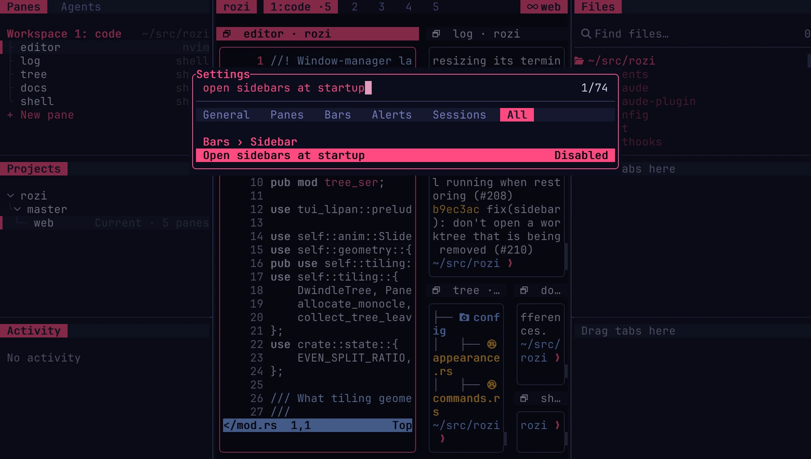
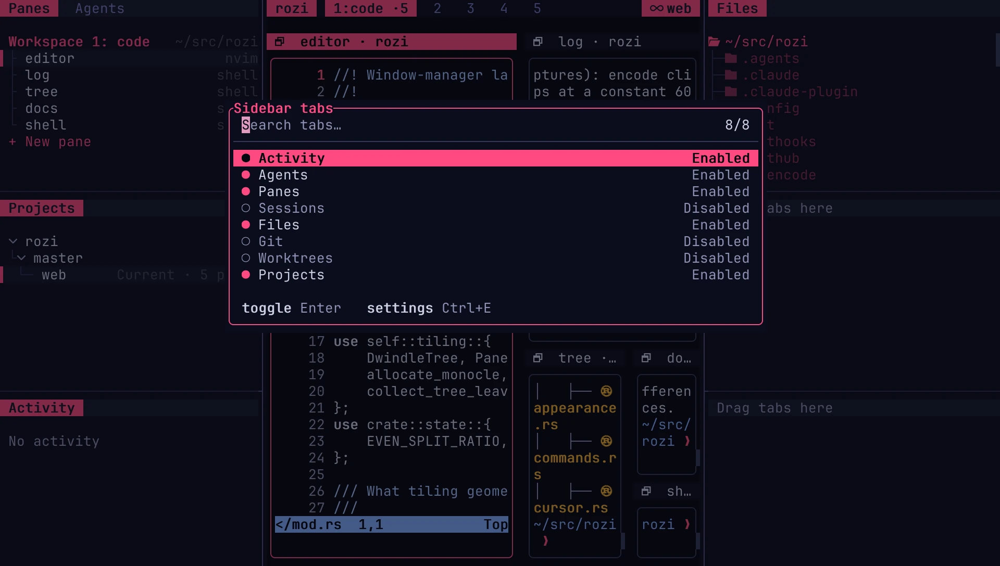

# Sidebar

The sidebar provides optional left and right docks beside your panes with tabs for activity, agents,
panes, sessions, files, Git changes, worktrees, and projects. This page covers opening and navigating it, what each tab shows, and how to
configure tabs or add your own.

The sidebar belongs to your client. It is never part of a shared session layout.

Rows in Sessions, Worktrees, Projects, and described command or extension trees share space
between the name and its description. When both are long, the name keeps at least 40% of the
available text width. Short names and descriptions leave their unused space to the other side;
there are no fixed columns. Tree guides, icons, and row controls sit outside that text budget.

<CaptureGallery title="~/src/rozi — web">


</CaptureGallery>

## Open the sidebar

Press `Ctrl+A`, then `b` to show or hide the sidebar. Press `Ctrl+A`, then `B` to show it and move
keyboard focus into its rows. `Esc` returns focus to the pane.

While the sidebar is visible, these command keys work without focusing it:

| Command key | Action |
| --- | --- |
| `PageDown` | Next tab |
| `PageUp` | Previous tab |

Open **Settings… → Bars → Left panels…** or **Right panels…** to split a dock into one to three
panels. `Enter` applies the choice and `Esc` cancels.

**Show/Hide left sidebar** and **Show/Hide right sidebar** in the command palette toggle one dock
at a time. They have no default keys; bind them as `toggle-left-sidebar` and
`toggle-right-sidebar`. The `b` command key hides whichever docks are shown and later brings back
the same ones.

rozi remembers which docks were open when you leave and opens them again next time. Turn off
**Open sidebars at startup** in Settings to start with both docks hidden; `b` still brings back the
remembered docks.

<CaptureGallery title="Sidebar settings" mode="steps">



</CaptureGallery>

Clicking a row runs its action without moving keyboard focus away from the pane. The sidebar is not
part of the normal `Tab` focus order.

## Navigate a focused sidebar

After the `B` command key focuses the sidebar:

| Key | Action |
| --- | --- |
| `j/k` or arrows | Move through selectable rows |
| `PageUp`, `PageDown` | Move by a page |
| `g`, `G`, `Home`, `End` | First or last row |
| `Enter` | Activate the selected row |
| `Ctrl+Enter` | Files/Git: insert the selected file or directory path into the focused pane |
| `x` | Close the selected row; press again to confirm |
| `Tab`, `Shift+Tab` | Next or previous tab |
| `h/l`, arrows, `Space` | Collapse, expand, or toggle directories and [tree rows](#expand-and-collapse) |
| `Alt+Left/Right`, `Alt+h/l` | Move the active tab; cross into the other visible dock at the inner edge |
| `Ctrl+Up/Down`, `Ctrl+k/j` | Focus the previous or next panel in this dock |
| `Ctrl+Left/Right`, `Ctrl+h/l` | Focus the dock in that direction, keeping the panel level |
| `Alt+Up/Down`, `Alt+k/j` | Move the active tab to the previous or next panel |
| `Shift+Left/Right`, `Shift+h/l` | Resize the sidebar |
| `Shift+Up/Down`, `Shift+k/j` | Resize the panel split |
| `?` | Open Keybindings… |
| `Esc` | Return focus to the pane |

With the mouse, drag the sidebar's outer edge to resize it, within the same 16 to 80 columns that
`width` allows. Drag the divider between panels to change the split.

Tab order, tab visibility, dock widths, and panel sizes are saved to `config.toml`, so they apply
to every client.

## Activity

Activity lists everything happening in the session: detected coding agents, agents that report
their own state, statuses set with `rozi status`, and rows published with `rozi publish`. Only the
agents among them also appear in the [Agents view](sessions.md#go-to-an-agent); see
[Activities and agents](control-protocol.md#activities-and-agents). Rows are grouped by
the Git project that contains each pane's working directory, with branch and workspace context. A
published row can name its own directory, so a program that runs several sessions in separate
worktrees shows each one under its own branch. A linked Git worktree is labelled with its
repository's name, and the branch beside it tells the checkouts apart: when several checkouts of one
repository are listed, the branch keeps its room in a narrow sidebar, showing its end, and the
repository name shortens. A checkout with no branch shows its short commit.

If you run many worktrees of one repository at once, set the tab's **Worktrees** setting to
**By repository** to name each repository once, with a line per checkout's branch and its agents
beneath. A repository with one checkout keeps its usual heading, its branch beside its name:

```toml
[sidebar.settings.activity]
worktrees = "repository"
```

```text
rozi
├ master
│ └ ⠋ Claude Code
├ fix/ssh
│ └ ▲ Codex
└ feat/sidebar
  └ ⠋ Claude Code
```

The default, **Separate**, gives each checkout a section of its own.
Selecting a row focuses its pane. For a published row, it also asks the program to show that
activity.

When an agent runs more than once in one project, such as Claude Code with background sessions or
in two panes, its runs are listed beneath one row for the agent, titled by what each works on. A
run with no title is named after its terminal title or the agent, numbered when two would read the
same. The agent's row shows its most urgent run's state, and selecting it collapses or expands the
runs. Collapsed, it counts its runs by state, such as `▲1 ⠋2 ✓1`, leaving idle ones
out. When the runs are on different workspaces, each one shows its workspace number. Runs in a
pane with no known directory are grouped only with other sessions in the same pane.

Each row shows `Blocked`, `Working`, `Done`, `Error`, or `Idle` in its configured status colour.
Blocked rows use `▲` in the warning colour and failed ones `×` in the error colour, so work waiting
for you stands apart from work that failed. A finished run stays marked `Done` until you look at
the agent: focus its pane or, for one of several sessions in a pane, switch to that session.
Programs can report their own progress here; see [Program status](terminal.md#program-status). Agent state comes from the session server, so every
attached client sees the same thing.

Activity covers the session on screen. For agents in other local sessions and on connected hosts,
use the [Agents](#agents) tab or the [Agents view](sessions.md#go-to-an-agent) (`Ctrl+A`, then
`a`).

rozi ships definitions for common coding-agent CLIs. To add or override one, see
[Agent definitions](agents.md).

## Agents

Agents lists the coding agents that need you, wherever they run: in the session on screen, in your
other running local sessions, and on every [connected host](remote.md#connected-host-monitoring).
An agent needs you when it is waiting for an answer, when it failed, or when it finished a run you
have not looked at. Agents still working, idle agents, and finished runs you have seen are left
out; Activity shows what is happening in the session on screen, and the
[Agents view](sessions.md#go-to-an-agent) (`Ctrl+A`, then `a`) lists every agent. With nothing
needing you, the tab reads `No agents need attention`.

```text
▲ Fix SSH reconnect 3m20s      dev
  Claude Code  Permission required
× Migrate the schema   backend@workbox
  Codex               Thread failed
● Add filesystem watcher       dev
  Claude Code                 Done
```

Agents waiting for you come first, then failed ones, then finished runs. A row is titled by the
agent's task when it names one, such as the title of a session that Claude Code, Codex, or OpenCode
lists, and by the agent's name otherwise; two rows that would read the same are numbered. The
session it runs in is on the right, as `session@host` on a connected host. The second line names the
agent and gives the reason for its state when it gave one, such as `Permission required`. A row
without a task shows its state and the project and branch the agent works in instead.

Agents in the session on screen also show a time: how long a blocked state has held, or how long a
finished run took. A marker in the left margin shows the agent in the focused pane.

A finished run reads `Done` with a filled `●` until you look at the agent: focus its pane, or for
one of several sessions in a pane, switch to that session. It then leaves the tab. Looking at an
agent anywhere counts everywhere, whichever session or host it runs in. Runs that finished before
rozi attached to a session or connected to a host are not listed.

Activating a row goes to that agent: it focuses the pane in the session on screen, and switches to
or attaches the session first anywhere else. Unlike Activity, Agents lists only agents, never other
activities such as `rozi status` reports or published activity rows.

## Panes

Panes lists live panes grouped by workspace. Each workspace is a heading that shows the directory
its panes share, with one row per pane beneath it. A row shows the pane title and its foreground
program. A pane in another directory also shows where it is, relative to the heading's directory
when it is inside it. Activating a row switches to that workspace and focuses the pane. Each group
ends with **+ New pane**, which opens a pane on that workspace.

To close a pane, hover its row and click `x` twice, or select the row in a focused sidebar and press
`x` twice. This confirmation always applies, whatever your `[confirm]` settings.

Pane titles follow the order described in
[Layouts and panes](layouts-and-panes.md#titles-and-exited-panes).

## Sessions

Sessions lists local sessions and known remote hosts. `LOCAL` and each host are headings, with
their sessions and a row to start a new one beneath them. Activating a live session attaches or
switches to it. Restorable sessions, and cached rows for offline hosts, stay listed when available.

Session rows show `Current`, `Background` for a connection held by this client, or `Running`
for a live session this client is not attached to. `Reconnecting` and `Offline` describe retained
connections that are unavailable. Stopped sessions with saved snapshots show `Restorable`;
offline hosts' cached sessions show `Last seen`. When other clients share a session, their
number follows its state, such as `Current · 󰍺 1`. Agent activity is shown separately.

Session names belong to their host, so a local `dev` session and a remote `dev` session are
separate rows.

Remote hosts add these rows:

- An offline host has a connect row.
- An online host has a disconnect row and a new-session row. Disconnecting detaches this client but
  leaves named sessions on the host running.
- A session on a connected host that you are not attached to shows what its agents are doing, such as
  `4 panes · 2 blocked`. See
  [Agents on a machine you are not in](remote.md#agents-on-a-machine-you-are-not-in).

The last row, **+ Connect a host…**, opens the same prompt as `Ctrl+N` in **Sessions → Remote
hosts**. rozi remembers a new host only after it connects successfully. A host is contacted only
when you expand or connect it, not when you open the tab.

To kill a session, hover its row and click `x` twice, or select it in a focused sidebar and press
`x` twice. Killing the session you are in leaves you in the session picker or the sessionless
launcher.

See [Sessions](sessions.md) for session management and [Remote sessions](remote.md) for host setup
and authentication.

## Files

Files browses the focused pane's working directory. It follows focus and `cd`, and directories load
when you expand them. rozi remembers which directories are expanded until the client exits.

Files and Git follow the global `nerd_icons` setting. When enabled, they show colored file icons
and Nerd Font Git marks, hide expansion arrows, and indent two cells per level. When disabled,
they hide file icons, show Unicode expansion arrows and text Git marks, and indent one cell per
level. Both modes use Branch guides. Unicode mode leaves one cell after guides or arrows; Nerd
icon mode has no guide gap and leaves one cell between file icons and labels. File-icon colors
come from the active theme's `file_icons` palette, and
Unicode arrows use its muted color. Remove the old per-tab `icons` option from your configuration.

Activating a file runs the tab's `on_click` action. By default, that types the path into the focused
pane without pressing `Enter`.

Ctrl+click a file or directory to insert its path into the focused pane without pressing `Enter`.
Ctrl+Enter does the same for the selected entry while the tree has keyboard focus. This gesture
always inserts the path, independently of a custom `on_click` action, and does not expand or
collapse directories. Ordinary directory clicks still expand or collapse them. The shortcut is
available in both Files and Git.

A symlink shows its target, as in `guide-link.md → AGENTS.md`. The target is the link's own text,
not a resolved path, and clicking the row acts on the link itself. With Nerd Font icons, a link to a
directory has a linked-folder icon and a link to a file has a linked-file icon. A linked directory
does not expand.

Hidden entries, whose names start with a dot, appear dimmed in Files and Git. Turn off the tab's
**Hidden files** setting to leave them out. Entries that Git ignores, such as a `target/` build
directory and everything in it, are dimmed too.

Turn on **Search bar** to filter the tree as you type. Files and Git also have **Root**, which
browses the focused pane's directory or the whole repository containing it, **Line counts**, and
**Entry limit**. See [Tab settings](#tab-settings).

In a remote session, the listing comes from the remote host, and search covers only directories you
have already expanded.

## Git

Git shows changed files for the repository that contains the focused pane's working directory, with
status markers and line-change counts when available. It always shows the whole repository, even
when the pane is in a subdirectory.

When all of a directory's changes are inside one subdirectory, the two share a row, as in
`src/view/sidebar`. Expanding or collapsing that row acts on the innermost directory. While
you search the tab, every directory gets its own row again. Turn off the tab's **Compact
directories** setting to always give each directory its own row.

In Files and Git, line-change counts appear before the status markers, as in `+42 -11 M`, so the
markers line up at the right edge. Nerd Font status symbols have a one-cell right margin to keep
their full size; text markers have no added right margin.

Instead of an empty tree, the tab says when the repository is clean, when the directory is not in a
repository, when it is loading, or when changes are unavailable. In a remote session, `git` must be
on the remote host's `PATH`.

Files and Git update as files change, usually within a fraction of a second. File listings follow
the directories you have open, and reopening a directory shows its current contents. Git status
follows every tracked directory, open or not, so a file an agent edits under a collapsed directory
still shows up as changed. It also refreshes when a command finishes. On a filesystem that does
not report changes, such as some network mounts, or in a repository with more than 4,096 tracked
directories, the tree rereads every five seconds instead. In a remote session, Files and Git
refresh when a command finishes and every few seconds. Neither tab refreshes while hidden: hide the
sidebar or switch every visible panel to other tabs and it stops.

## Worktrees

Worktrees lists the Git worktrees of the focused pane's repository, on the host running that pane's
session. A heading names the repository and host, with the checkouts beneath it. Each checkout is
listed by branch, with PR/CI
status underneath, such as `#114 · Passed` or `#112 · Merged`. Paths stay hidden; open the
**Worktrees** picker to search by path or copy one with `Ctrl+C`. A bar in the left margin marks
the checkout the focused pane is in. See [Read work status](worktrees.md#read-work-status) for
GitHub setup and status meanings.

The marker on the right shows whether a session was started from that checkout, using the same
markers as the [Sessions picker](sessions.md#use-the-session-picker):

| Marker | Session |
| --- | --- |
| `●` | The one you are in |
| `◐` | Held by this client in the background |
| `↻` | Held by this client and reconnecting |
| `×` | Held by this client, with its connection lost; activating reconnects |
| `○` | Running on the host; activating attaches to it |
| `◌` | Saved; activating restores it |

A number after the marker counts the sessions using the checkout. `Primary`, `Locked`,
`Stale lock`, or `Prunable` appears to its left when it applies; see
[Unlock a worktree](worktrees.md#unlock-a-worktree). When you hover the row, the marker changes to
what activating it does: `open`, `switch`, `connect`, `attach`, `restore`, `choose`, or `new session`.

Activating a checkout opens its session. If several sessions use it, you choose one. If none do,
rozi creates a session whose first shell starts in the checkout.

**+ New worktree** opens the new-worktree form. The checkout appears as `Creating…`, and its session
opens when Git finishes.

To remove a linked checkout, hover it and click `x` twice, or select it in a focused sidebar and
press `x` twice. The branch is kept unless `[worktrees] delete_branch` says otherwise (see
[Delete the branch too](worktrees.md#delete-the-branch-too)). If Git refuses because the checkout has uncommitted changes,
the row asks once more before forcing the removal. A checkout with a stale lock has an `x` too;
confirming it unlocks the checkout and removes it. The primary checkout, checkouts with any other
lock, and checkouts a session uses have no `x`.

The list follows the focused pane and refreshes along with the Git tab, so a checkout you add from
a shell appears without further action. See [Worktrees](worktrees.md) for the picker, the CLI, and
settings.

## Projects

Projects lists every Git checkout any of your sessions works in — on this machine and on every
[connected host](remote.md#projects-on-a-machine-you-are-not-in) — arranged by repository:

```text
 ▼ ▲ rozi
 ├▼ master
 │└─ api                1 pane
 └▼ ▲ fix/ssh
▍ └─ ▲ fix    Current · Codex
```

Each repository lists its checkouts by branch, the primary checkout first, and each checkout lists
the sessions working in it. A session is listed under every checkout one of its panes or agents
works in, so a session with panes in two repositories appears under both. A row's status glyph shows the
most urgent agent below it: blocked, then failed, then a finished run you have not looked at,
then working. A session row names its agent, counts
several, or counts its panes when none runs an agent. When more than one machine has work, each
machine gets a heading, `LOCAL` for this one.

Session rows show pane or agent counts. Sessions held by this client also show their state, such
as `Current`, `Background`, or `Reconnecting`. Other running sessions omit the `Running` word.
The activity glyph describes the most urgent agent, independently of the session's connection
state. Saved restore snapshots do not add entries to Projects.

The accent bar and subtle background mark the session row for the focused pane's checkout. Other
appearances of the same session have neither. Collapsing its checkout or repository moves the
marker to the nearest visible collapsed row. The stronger row background follows the keyboard
selection while the sidebar is focused.

Activating a session row keeps the focused pane when it already belongs to that checkout and
session. Otherwise it goes to the most urgent agent working there, or to a pane there when none
is, switching to or attaching the session first if needed. Activating a repository or checkout
row shows or hides what is under it.

Projects lists where sessions work, not every checkout on disk; the [Worktrees](#worktrees) tab
lists a repository's checkouts whether or not a session uses them. Panes outside a Git repository
are not listed. With none to show, the tab reads `No sessions in Git`. If a remote host becomes
unreachable, its heading shows its connection state while its unavailable work is hidden. Sessions
still connected to this client remain listed, including those held in the background.

### Expand and collapse

Projects, [JSON command tabs](#json-command-tabs), and [stream tabs](#stream-tabs) are trees. Click
the disclosure chevron beside a row to show or hide what is under it. These trees use the Files
tab's compact guide style. Files and Git hide arrows when Nerd icons are enabled and use `▼`
and `▶` otherwise. The other trees use Nerd Font chevrons when enabled, with the same Unicode
arrows as a fallback.
Status icons appear only on rows with a status to report. In a focused sidebar:

| Key | Action |
| --- | --- |
| `Right`, `l` | Expand the row, or move to its first child when it is already expanded |
| `Left`, `h` | Collapse the row, or move to its parent |
| `Space` | Expand or collapse the row |

rozi remembers which rows you expanded or collapsed until the client exits.

## Configure tabs and panels

<CaptureGallery title="Sidebar tabs">

</CaptureGallery>

Open **Settings… → Bars → Sidebar tabs…** to choose which tabs appear. Search by name and press
`Enter` to turn a tab on or off; the picker stays open so you can change several. A tab with
[settings](#tab-settings) counts them beside its status, as in `Enabled · 5 settings`, and `Ctrl+E`
opens them. A tab from an extension that is not loaded stays
listed with a dash and keeps its place for when it returns.

Arrange tabs by dragging them, or with the focused-sidebar keys above. Drop a tab on another
panel's body to add it at the end, or on its tab bar to choose its position. A tab you turn off and
on again returns to where it was.

When extensions provide presets, **Settings… → Bars → Sidebar layout preset…** offers them alongside
the default layout.
Highlighting a preset leaves the workspace unchanged; Enter applies it and Escape cancels. Presets
are starting configurations, so later edits remain yours.

```toml
[sidebar]
startup = false
tabs = ["activity", "agents", "panes", "sessions", "files", "git", "worktrees", "projects"]
layout = { left = { width = 32, panel_count = 2, panels = [
  { weight = 0.4, tabs = ["activity", "agents", "panes", "sessions"] },
  { weight = 0.6, tabs = ["files", "git", "worktrees", "projects"] },
] }, right = { width = 32, panel_count = 1, panels = [{ weight = 1.0, tabs = [] }] }, hidden = [] }
background_follows_canvas = false
gap = true
background = true
tab_style = "padded"
```

The `layout` value can also be written as nested TOML tables. Reducing a dock's panel count moves
the extra tabs into its last panel, and raising it again restores them. On a narrow terminal the
docks shrink to leave room for your panes, without changing their saved widths.

`background_follows_canvas`, `gap`, `background`, and `tab_style` set the look of both docks.

See [Configuration](configuration.md#sidebar) for defaults, size limits, file tree options, and
custom tab syntax. A complete example is in [`examples/sidebar.toml`](../examples/sidebar.toml).

### Tab settings

Activity, Files, Git, and extension tabs that offer them have settings of their own. In
**Sidebar tabs…**, highlight the tab and press `Ctrl+E`, or run **Sidebar tab settings…** from the
command palette to open the settings of the tab shown in the focused panel. Each row shows a
setting's current value:

| Setting | Enter |
| --- | --- |
| `Enabled` or `Disabled` | Switches it |
| A choice, such as **Root** | Lists the values; `Enter` applies one |
| A number or text | Asks for the value; a number outside its range is refused |

`Ctrl+R` puts the highlighted setting back to its default. Each change is saved to `config.toml`
and takes effect at once; `Esc` returns to **Sidebar tabs…**, or to your panes when you opened the
settings from the command palette.

A built-in tab's settings are saved in `[sidebar.settings.<tab>]`; see
[Built-in tab settings](configuration.md#built-in-tab-settings) for the keys. An extension tab's
settings are the extension's own, saved in `[extensions.<id>]`, and the picker names the extension
in its header. Changing one restarts the extension's services, as editing the file would.

## Custom tabs

You can add three kinds of tab of your own:

- A launcher tab lists configured entries. Each entry runs a `run`, `send`, or `popup` action, the
  same actions custom key commands use.
- A command tab runs a command and shows its output as rows: one row per line, or a tree of rows
  when the command prints JSON.
- A stream tab shows rows that running programs publish to it, and tells them when you click,
  expand, or act on a row.

Extensions can add tabs of every kind; see [Extension sidebar tabs](#extension-sidebar-tabs).

### Launcher tabs

An entry's `group` puts it beneath a heading like the ones in Activity, Panes, and Sessions.
Groups appear in the order they first occur, and entries without a group come first, without a
heading. For example, a tab that starts an agent in a project, grouped by agent:

```toml
{ name = "launch", label = "Launch", entries = [
  { label = "rozi", group = "claude", run = "cd ~/Projects/rozi && claude" },
  { label = "rozi", group = "codex", run = "cd ~/Projects/rozi && codex" },
] }
```

### Command tabs

A command tab runs its command when the tab becomes visible, then again at its configured
interval. The interval is at least five seconds. Each run is limited to:

- a five-second timeout
- 64 KiB of combined output
- 500 rows
- 4096 characters kept per row
- 160 characters displayed per row

rozi strips terminal control sequences from the output. A command that fails to start, times out,
writes to standard error, or exits non-zero shows non-clickable error rows.

To group the output, set `group_prefix`. Each output line that starts with the prefix becomes a
heading showing the rest of the line, with the lines after it beneath it. A line that is only the
prefix is dropped. Headings cannot be selected. `group_prefix` applies only to command tabs; launcher tabs use `group`.

A command tab runs in the focused pane's working directory, so it describes the project you are
working in and runs again when you `cd`. If the tab was off screen while you changed directory, it
shows its placeholder until the new result arrives, not the previous project's rows. With
`--remote`, the pane's directory is on the server, so the tab runs in the client's own directory.

### JSON command tabs

With `format = "json"`, a command tab's command prints one JSON object describing its rows instead
of one row per line. Rows can nest, carry a state, and say more than a line of text can:

```toml
{ name = "deps", label = "Deps", command = "deps-report --json", format = "json", on_click = { run = "deps-open \"$ROZI_ROW_ID\"" } }
```

```json
{"rows":[
  {"id":"serde","label":"serde","description":"1.0.219","tone":"warning","detail":"1.0.228 available"},
  {"id":"serde/derive","parent":"serde","label":"serde_derive","description":"1.0.219"}
]}
```

| Field | Meaning |
| --- | --- |
| `id` | Required. The row's identity, unique in the output. Expansion and clicks follow it. |
| `label` | Required. The row's text. |
| `parent` | The `id` of the row it sits under. A missing parent makes it a top-level row. |
| `description` | Right-aligned text on the label's line. |
| `meta` | A short value beside the label, such as how long something has run, in the row's state colour. |
| `detail` | A second line under the label. |
| `tone` | The row's state, which picks its marker and colour: `normal`, `muted`, `info`, `working`, `success`, `warning`, `blocked`, or `error`. |
| `active` | Marks the current one of its kind. |
| `disabled` | Shows the row dimmed with this reason as its second line, and makes it inert. |
| `expanded` | Whether the row starts expanded. Your own choice wins once you make one. |
| `heading` | Shows a top-level row as a section heading, with its rows always open beneath it. A heading cannot be activated, and its `description` sits at the right edge. |

A row with children starts expanded unless it says otherwise. A collapsed row tints its arrow with
the most urgent state among the rows it hides. Activating a row runs the tab's
`on_click` with the row's `id` in `ROZI_ROW_ID` and its label as the row text, so `send` may use
`{line}` for the label. Without `on_click`, activating a row with children shows or hides them.

The same limits apply as for line output, and unknown fields are ignored. Output that is not such
an object, a command that fails, or one that writes to standard error shows error rows instead.
rozi strips control sequences and shortens long text. A command tab cannot use `group_prefix`
with `format = "json"`; nest rows with `parent` instead.

### Stream tabs

A stream tab has no command of its own. Programs publish its rows with
[`rozi sidebar publish`](control.md#sidebar-streams) while they run, and rozi tells them what you do
with those rows. Use one for something a program already watches: deployments, build jobs, a test
watcher, the machines a service is connected to.

```toml
{ name = "deploys", label = "Deploys", stream = true }
```

```sh
deploy-watch | rozi sidebar publish --tab deploys
```

Each line a program writes is a complete snapshot of its rows, in the same row format as a
[JSON command tab](#json-command-tabs). When you activate a row, expand a row marked `expandable`,
or press one of the program's action keys on a row, rozi writes a line back. Several programs can
publish to one tab at once; each owns only its own rows, and each gets a heading when there is more
than one, such as `LOCAL · prod` or `WORKBOX`. A program that exits takes its rows with it.

A program can offer actions on its rows, each bound to a key that works while the sidebar is
focused. One action can be the row's `✕`, which, like every `✕` in the sidebar, asks for a second
click or `x`. The sidebar's own keys are never available to a program. See the
[protocol](control-protocol.md#sidebar-stream) for the full format.

Only processes you run and the extension that owns a tab can publish to it: an extension's
processes publish only to that extension's own stream tabs, and other programs only to stream tabs
in your `config.toml`.

### Pass the selected row or path

| Action | Tab | How the selection is passed |
| --- | --- | --- |
| `send` | Command | `{line}` in the text is replaced with the row |
| `run`, `popup`, `exec` | Command | `ROZI_ROW` environment variable |
| any | JSON command | the row's `id` in `ROZI_ROW_ID`, its label as above |
| `send` | File tree | `{path}` in the text is replaced with the path |
| `run`, `popup` | File tree | `ROZI_FILE` environment variable |

`{line}` is the row after control sequences are stripped, sent literally — rozi does not quote or
evaluate it. `{line}` is rejected in `run` and
`popup`. When passing `ROZI_ROW` or `ROZI_FILE` to another program, quote it as `"$ROZI_ROW"` or
`"$ROZI_FILE"`. A row is command output and must never be used to build a command line.

### Extension sidebar tabs

Extensions add tabs with `[[sidebar_tabs]]` in their manifest, using the same launcher, command, and
stream forms. Their ids are `<extension>.<name>`. They may suggest an initial dock and panel. Your saved placement takes precedence and survives
disablement, failed loads, updates, removal, and reinstallation. An extension tab can offer some of
the extension's settings in [Tab settings](#tab-settings). See
[Extensions](writing-extensions.md#sidebar-tabs).

### Security

Custom commands run as your user through the configured `command_shell`. Treat sidebar
configuration as executable code, and treat command output and filenames as untrusted input.

## Shared sessions

The sidebar's visibility, tabs, panels, selection, and cached data belong to each client. In a
[shared session](shared-sessions.md), the controller's sidebar still narrows the shared terminal
width, because the controller sets the size of the pane area everyone sees. A follower's sidebar
does not resize shared panes. See [Shared sessions](shared-sessions.md#terminal-size).
